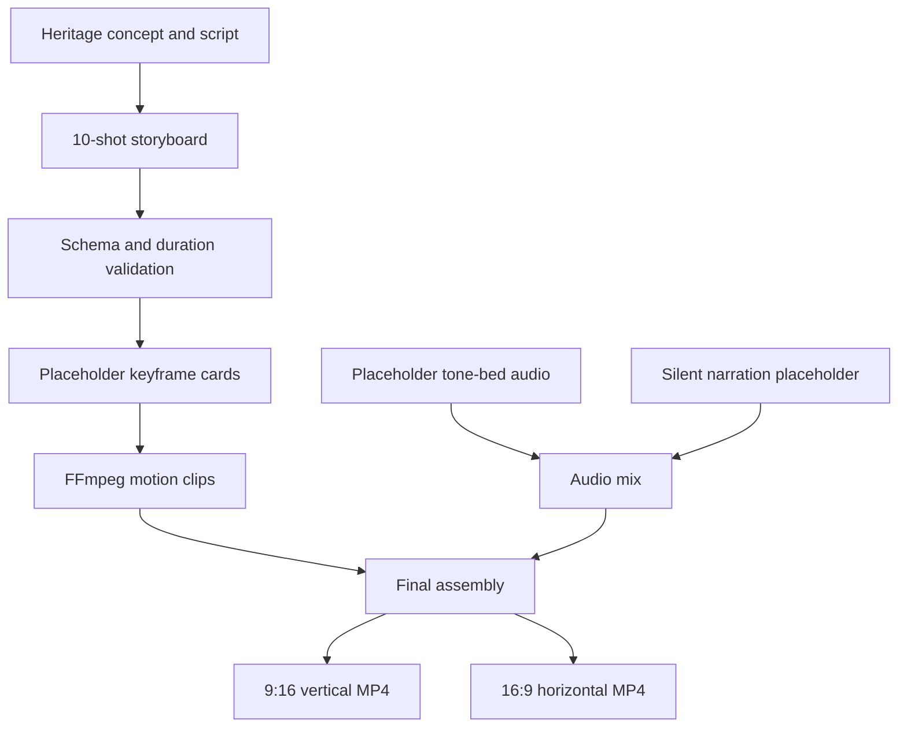

# Production Pipeline Architecture

## Source of truth
`storyboard.json` defines the title, languages, frame rate, runtime, visual style, music brief, and timed shots. Validation runs before media generation.

## Stage sequence
1. Validate JSON Schema and shot-duration sum.
2. Create labeled offline placeholder keyframe cards.
3. Render slow-motion/zoom draft clips with FFmpeg.
4. Synthesize a tonal placeholder audio bed.
5. Create a silent narration WAV; Amharic text remains in the storyboard.
6. Concatenate clips, mix audio, and export vertical and horizontal MP4 files.

## Caching and run logs
Stages cache outputs using hashes of relevant inputs. `runs.jsonl` records stage, implementation label, parameters, seed, elapsed time, cost, status, output path, and notes. Production cache keys should include provider model/version and all upstream dependencies.

## Failure recovery
Stages are independent Python modules. Keep completed outputs, fix the failing stage, and rerun. FFmpeg motion rendering is a deterministic fallback when a video-generation provider is unavailable.

## Known limitations
Keyframes are placeholder cards, music is a synthesized tone bed, and narration audio is silent. The horizontal export center-crops portrait imagery and needs a dedicated landscape composition pass. Real provider adapters and provider-specific retry/error handling are not implemented.